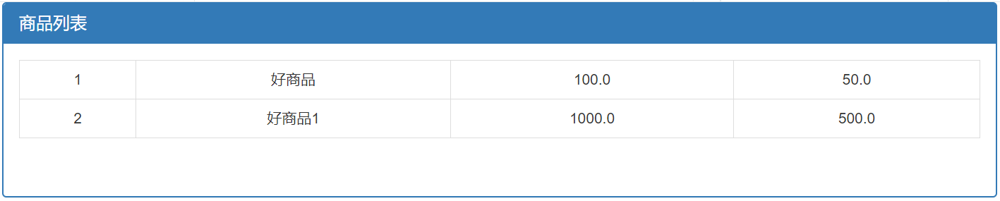

# web — Java Web 课程练习仓库

《Web 开发技术》课程练习的合集：一份课堂参考实现、三个 Spring Boot 练习工程、一个 Maven 空壳工程和一个 ASP.NET 空模板，另有早期归档包与许可证。

各工程**互相独立**：没有共享模块、父子 POM 或统一构建，请分别打开、分别构建。

## 项目一览

| 目录 | 内容 | 技术栈 | 构建 / 测试（2026-10-20 实测） |
| --- | --- | --- | --- |
| [`demo/`](demo/) | 课堂参考实现：登录模块（index / login / main） | Spring Boot 4.1.1 · Java 21 · Thymeleaf | ✅ 1/1 通过（JDK 21） |
| [`jsj2434/`](jsj2434/) | 课程实验复刻 + MyBatis/MySQL 认证 + 全局异常处理 | Spring Boot 4.0.8 · Java 21 · Thymeleaf · MyBatis · MySQL 8 | ✅ 16/16 通过（JDK 21） |
| [`shiyan2/`](shiyan2/) | 实验二：Thymeleaf 商品信息管理（添加 + 列表） | Spring Boot 4.1.1 · Java 17 · Thymeleaf | ✅ 1/1 通过（JDK 17） |
| [`Test34/`](Test34/) | Maven 练习空壳：Hello World + MySQL 驱动 | Java 21 · mysql-connector-j 8.4.0 | ⚙️ 可编译，无测试 |
| [`sy1/`](sy1/) | VS2022 ASP.NET Web 应用空模板 | .NET Framework 4.7.2 · IIS Express | ⛔ 未开发 |

## 目录结构

```
web/
├── demo/                     课堂参考实现（com.example.demo）
│   ├── src/main/java/com/example/demo/{controller,domain,service}
│   ├── src/main/resources/{application.properties,templates/{index,login,main}.html}
│   └── src/test/java/com/example/demo/DemoApplicationTests.java
├── jsj2434/                  课程实验复刻 + 数据库认证（com.zjsru）
│   ├── src/main/java/com/zjsru/
│   │   ├── controller/UserController.java          7 个页面 / 演示路由
│   │   ├── exception/GlobalExceptionHandler.java   统一 Result JSON 异常响应
│   │   ├── mapper/UserMapper.java                  MyBatis 查询 users 表
│   │   ├── service/{UserService,UserServiceimpl}.java
│   │   └── domain/{Users,Result}.java
│   ├── src/main/resources/{application.properties,schema.sql,templates/{index,login,main}.html}
│   └── src/test/java/com/zjsru/                    5 个测试类 / 16 个用例
├── shiyan2/                  实验二：商品信息管理（com.example.shiyan2）
│   ├── src/main/java/com/example/shiyan2/{controller,model,service}
│   ├── src/main/resources/{templates/{addGoods,goodsList}.html,static/css/goods.css}
│   └── src/test/java/com/example/shiyan2/Shiyan2ApplicationTests.java
├── Test34/                   Maven 空壳工程（org.example）
├── sy1/                      ASP.NET Web 空模板
├── AGENTS.md                 在本仓库工作的规则（改代码前先读）
├── HANDOFF.md                交接状态与历史记录
├── README.md                 本文件
├── demo.zip                  demo 的早期快照（与当前 demo/ 不同源，勿当源码用）
├── jsj2434.rar               早期 jsj2434 快照（未解压核对）
└── LICENSE                   GPL-3.0
```

## 环境要求

| 组件 | 说明 |
| --- | --- |
| JDK | `demo`、`jsj2434`、`Test34` 需要 **JDK 21**（`D:\pc\.jdks\graalvm-jdk-21.0.7`）；`shiyan2` 需要 **JDK 17**（`D:\pc\.jdks\graalvm-jdk-17.0.12`）。PATH 上的 JDK 15 不能用于构建 |
| Maven | 系统没有全局 `mvn`，一律用各项目自带的 `mvnw.cmd`（wrapper 3.3.4 / Maven 3.9.16）。`.mvn/settings.xml` 把依赖镜像到阿里云 |
| MySQL | 只有 `jsj2434` 需要：MySQL 8，`localhost:3306`，账号 `root/root`，库名 `jsj2434` |
| 端口 | `demo` 与 `jsj2434` 默认都占用 8080，不要同时启动；需要并行时加 `--server.port=8081` |

## 快速开始

```powershell
# demo：课堂参考实现
cd demo
$env:JAVA_HOME = 'D:\pc\.jdks\graalvm-jdk-21.0.7'
.\mvnw.cmd spring-boot:run        # http://localhost:8080/ ，账号 admin / 123

# jsj2434：实验复刻 + 数据库认证
cd jsj2434
$env:JAVA_HOME = 'D:\pc\.jdks\graalvm-jdk-21.0.7'
.\mvnw.cmd spring-boot:run        # 启动时自动执行 schema.sql 建表

# shiyan2：实验二
cd shiyan2
$env:JAVA_HOME = 'D:\pc\.jdks\graalvm-jdk-17.0.12'
.\mvnw.cmd spring-boot:run        # http://localhost:8080/shiyan1/toAdd

# 任意项目跑全量测试
cd <项目目录>
.\mvnw.cmd -B clean test
```

> 没有设置 `JAVA_HOME` 时 `mvnw` 会退回 PATH 上的 JDK 15，构建会直接失败。

## 各项目说明

### demo/ — 课堂参考实现

老师给出的登录示例，`jsj2434` 就是照着它复刻的。账号写死在 `UserServiceimpl` 里（`admin` / `123`）。

| 方法 | 路径 | 行为 |
| --- | --- | --- |
| GET | `/` | 欢迎页 `index.html` |
| GET | `/tologin` | 登录表单 `login.html` |
| POST | `/login` | 校验成功则内部转发 `/toMain`，失败回到 `login` |
| GET/POST | `/toMain` | 主页 `main.html`，模型带 `username`；模板实际读 `session.username` |
| GET | `/logout` | 返回文本“退出成功”，不销毁会话 |
| GET | `/logout2` | 回到登录页并带 `message=退出成功` |

原样保留了源项目的行为：登录不写 session，所以主页用户名是空的；两个退出接口都不销毁会话。

### jsj2434/ — 课程实验复刻

在 `demo/` 的基础上扩展：

- **登录改为查库**：`UserMapper.selectByUsername` 查询 `users` 表，`UserServiceimpl` 比对数据库中的密码，不再使用硬编码账号。
- **自动建表**：`src/main/resources/schema.sql` 由 `spring.sql.init.mode=always` 在启动时执行，建表并写入演示账号（`admin/123`、`alice/123456`），脚本是幂等写法。
- **统一异常响应**：`GlobalExceptionHandler` 捕获控制器里的空指针、算术和其他异常，统一返回 `Result{code=500, msg, data=null}` 的 JSON，HTTP 状态仍是 200。

| 方法 | 路径 | 行为 |
| --- | --- | --- |
| GET | `/` | 欢迎页 |
| GET | `/tologin` | 登录表单 |
| POST | `/login` | 查 `users` 表校验，成功内部转发 `/toMain`，失败回 `login` |
| GET/POST | `/toMain` | 主页，模型带 `username` |
| GET | `/logout` | 文本“退出成功” |
| GET | `/logout2` | 登录页 + `message=退出成功` |
| GET | `/testException` | 故意整数除零，演示全局异常处理的 JSON 响应 |

测试 16 个：页面 2、控制器流程 6、服务 2、上下文 1、异常处理 5。

### shiyan2/ — 实验二：商品信息管理

Thymeleaf 表单绑定与列表渲染练习，数据保存在 `GoodsServiceImpl` 的静态 `ArrayList` 里（进程重启即清空，不涉及数据库）。

| 方法 | 路径 | 行为 |
| --- | --- | --- |
| GET | `/shiyan1/toAdd` | 渲染添加商品表单 `addGoods.html` |
| POST | `/shiyan1/addGoods` | 接收 `Goods`（名称、原价、折扣价），加入列表并渲染 `goodsList.html` |



添加页截图见 [`shiyan2/addGoods.html.png`](shiyan2/addGoods.html.png)；实验报告在 `shiyan2/` 下（`实验一实验报告.docx`、`实验二_Thymeleaf实验报告.doc`）。

### Test34/ — Maven 空壳工程

`org.example:Test34`，只有一个打印 `Hello and welcome!` 与 1..5 的 `Main.java`，依赖 `mysql-connector-j` 但没有任何连库代码。已补 Maven Wrapper，可以 `.\mvnw.cmd compile`，没有测试。

### sy1/ — ASP.NET Web 应用空模板

VS2022 新建的 ASP.NET Web Application（.NET Framework 4.7.2），只有 `AssemblyInfo.cs`、`Web.config` 和 Docker 配置，没有任何页面；需要 Windows + IIS Express，本仓库不做构建验证。

## 测试矩阵

| 项目 | 命令 | JDK | 结果 |
| --- | --- | --- | --- |
| `demo` | `.\mvnw.cmd -B clean test` | 21 | BUILD SUCCESS，Tests run: 1 |
| `jsj2434` | `.\mvnw.cmd -B clean test` | 21 | BUILD SUCCESS，Tests run: 16 |
| `shiyan2` | `.\mvnw.cmd -B clean test` | 17 | BUILD SUCCESS，Tests run: 1 |
| `Test34` | `.\mvnw.cmd -B clean compile` | 21 | BUILD SUCCESS（无测试） |

`jsj2434` 的测试会连本机 MySQL，跑之前确认 MySQL 8 已启动；表结构由 `schema.sql` 自动创建。

## 已知限制

- `demo` 与 `jsj2434` 都是课程演示：密码明文比较/存储，数据源账号 `root/root` 写在配置里，没有 CSRF、会话固定防护，不要当真实站点使用。
- `jsj2434` 保留源示例的行为：登录不写 session、退出不销毁会话，所以主页用户名显示为空。
- `Test34` 只有 Hello World；`sy1` 只有模板，均非完整应用。
- `demo.zip` / `jsj2434.rar` 是更早的快照，内容与目录中的源码不一致，不要以它们为准。
- Windows 受限沙箱里直接构建可能因 `target/` 写入被拒而失败（`AccessDeniedException`），这是会话权限问题，不是工程缺陷。

## 文档与约定

- [AGENTS.md](AGENTS.md) — 在本仓库工作的规则与红线，改代码前先读。
- [HANDOFF.md](HANDOFF.md) — 交接状态、历史记录与遗留问题。
- 提交信息沿用 `feat(scope): ...`、`fix: ...`、`docs: ...` 的形式，涉及具体项目时带作用域。
- 推送前请先确认：远端为 `git@github.com:dessert28/web.git`，分支 `main`。

## 许可证

仓库根目录的 [LICENSE](LICENSE) 为 GPL-3.0 全文，各子项目未单独声明许可。
